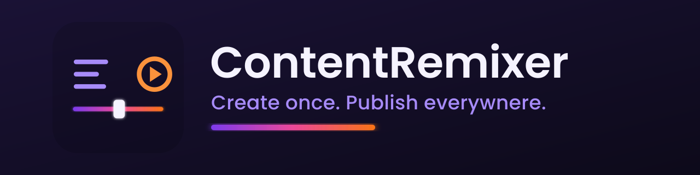
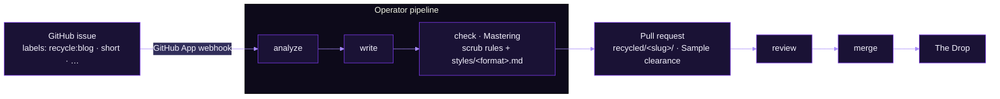

  

  
  
  
  

# ContentRemixer

**Create once. Publish everywhere.** ContentRemixer is an agentic content-remixing platform for DevRel teams: one source piece — a conference talk, a livestream, a blog post — becomes a blog, a YouTube short, a teleprompter script, or a tutorial, each written in your team's voice with source attribution baked in. You drive it from a GitHub issue; the agent opens a pull request you review and merge.

## How it works

You keep your reference content in this repo — **The Crate**. When you want a new format, you open an issue and tag it with a `recycle:*` label. A GitHub App picks it up, the operator runs a three-step pipeline, and you get a pull request with the remixed content, ready to review.

A human reviews and merges every Mix — the agent proposes, you decide.

## Features

- **One source, many formats.** Blog posts, YouTube shorts, teleprompter scripts, and tutorials from a single piece in the Crate — label it and go.
- **Your team's voice.** Per-format style guides and per-author voice cards condition the writer, backed by retrieval over your own content (RAG + pgvector).
- **Mastering before it ships.** Every Mix passes a brand-voice check plus hard scrub rules — no tenant IDs, tokens, IPs, or internal hostnames reach published copy.
- **Sample clearance on every PR.** Each remix is traceable to its source, with attribution attached.
- **Declarative by design.** You create Custom Resources (`ModelProfile`, `ReferenceRepo`, `DevRelPersona`), not config files; a validating webhook enforces the invariants.
- **The Booth.** A web UI + API to administer models, style profiles, and personas — including DevRel self-service onboarding (sources → style synthesis → content-test → validate → promote).
- **Any model.** Providers are fronted by an in-cluster LiteLLM gateway, so you point a `ModelProfile` at whatever you run.

## The brand language

ContentRemixer runs on a music-production metaphor — the vocabulary is part of the product.

| Term | Meaning |
|---|---|
| **The Crate** | This repo — the reference content library (`content/`). Crate digging = the scraper finding gems. |
| **Sample** | A source extract the agent pulls from a piece in the Crate. |
| **Mix / Remix** | The recycled output (lands in `recycled/`). |
| **Mastering** | The checker step — brand-voice pass + hard scrub rules. |
| **Sample clearance** | Source attribution attached to every PR. |
| **The Booth** | The admin web UI + API. |
| **The Drop** | Publication of an approved Mix. |
| **The Weekly Remix** | The newsletter module. |

## Architecture at a glance

ContentRemixer runs as a Kubernetes operator; there's no single-binary mode.

| Layer | What it is |
|---|---|
| **Operator** (`app/`) | Go/kubebuilder controller. Watches `recycle:*` issues, runs the **analyze → write → check** pipeline once per matched route, opens the PR. |
| **The Booth** (`booth/`) | Separate Go module (admin UI + API): AuthN (bcrypt users, signed sessions), the frozen §6.3 authorization predicate, CRUD, and DevRel onboarding. |
| **Web UI** | React SPA served from the Booth binary (`booth/web/`). |
| **Custom Resources** | `ModelProfile` (which model), `ReferenceRepo` (the Crate + label routes), `DevRelPersona` (voice + validation), enforced by a validating webhook. |
| **Data** | Postgres + pgvector for retrieval; LiteLLM gateway fronts the model providers. |
| **Deploy** (`deploy/`) | Kustomize bases + overlays; secrets created out-of-band, never committed. |

For the full picture, see the [Phase-1 operator design](docs/design/phase1-operator-design.md) and the [documentation home](docs/README.md).

## Getting started

New here? The **[Getting Started guide](docs/getting-started.md)** takes you from an empty cluster to your first remix in about 30 minutes — [concepts](docs/getting-started.md#1-how-contentremixer-works), [prerequisites](docs/getting-started.md#2-prerequisites), [install](docs/getting-started.md#3-install), [configure](docs/getting-started.md#4-configure), and a full [issue → PR walkthrough](docs/getting-started.md#5-your-first-remix-issue--pr).

In short:

1. **Install** with Kustomize onto a cluster (`kind` for local eval, or any real cluster). You'll need [cert-manager](https://cert-manager.io/), a GitHub App, a PAT, and at least one model-provider key — see [Prerequisites](docs/getting-started.md#2-prerequisites).
2. **Configure** a `ModelProfile`, point a `ReferenceRepo` at your Crate, and set your label routes.
3. **Remix.** Open an issue, add a `recycle:*` label, and review the PR the agent opens.

Running a cluster already? Jump straight to [Install → Configure → Your first remix](docs/getting-started.md#3-install).

## Repo layout

| Path | Contents |
|---|---|
| `content/` | Reference content by type (videos, blog, livestreams, podcasts), one folder per piece with a `meta.yaml`. |
| `styles/` | Per-format style guides the writer follows, plus `styles/authors/` voice cards. |
| `recycled/` | Generated Mixes, one folder per request, traceable to its source. |
| `app/` | The Kubernetes operator (Go, kubebuilder). |
| `booth/` | The Booth — admin web UI + API (separate Go module). |
| `deploy/` | Kustomize bases + overlays and the deploy runbook. |
| `branding/kit/` | The brand kit — logos, palette, voice & tone, badges. |
| `docs/` | Documentation (start at [`docs/README.md`](docs/README.md)). |
| `.github/ISSUE_TEMPLATE/recycle.yml` | The **Recycle request** issue form. |

## Documentation

| If you want to… | Read |
|---|---|
| Run your first remix | **[Getting Started](docs/getting-started.md)** |
| Browse everything | [Documentation home](docs/README.md) |
| Deploy to a cluster | [Deploy runbook](deploy/README.md) |
| Understand the architecture | [Phase-1 operator design](docs/design/phase1-operator-design.md) |
| Administer models & personas | [The Booth](booth/README.md) |
| Match our look & voice | [Brand kit](branding/kit/BRAND-KIT.md) · [Voice & Tone](branding/kit/VOICE-AND-TONE.md) |

## Contributing

Contributions are welcome — whether you're adding reference content to the Crate, tuning a style guide, or working on the operator.

- **Add or remix content** through the platform itself: open an issue, apply a `recycle:*` label (via the [Recycle request form](.github/ISSUE_TEMPLATE/recycle.yml)), and review the PR. Every Mix is reviewed and merged by a human.
- **Code changes** (operator, Booth, web UI) go through pull requests. Start from the [Getting Started guide](docs/getting-started.md) for the local-dev setup — the operator in `app/` needs Go 1.26; the Booth in `booth/` is a separate module referencing `app/` via a `replace` directive.
- **Match the brand.** Copy and UI follow the [Voice & Tone](branding/kit/VOICE-AND-TONE.md) one-pager and the [Brand kit](branding/kit/BRAND-KIT.md) — talk like a DevRel who ships: clear, a little playful, never hype.
- **Never leak internals.** No tenant IDs, tokens, IPs, or internal hostnames in content or committed config — Mastering enforces it, but keep it out from the start.

## License

ContentRemixer is licensed under the **[Apache License 2.0](LICENSE)**.

---

<strong>Create once. Publish everywhere.</strong> 🎛️

