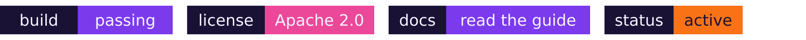

# ContentRemixer — Brand Kit

**Create once. Publish everywhere.** The single source of truth for how ContentRemixer looks
and sounds. The README and the marketing website both consume this kit — don't fork it.

Built on the **music-production metaphor**: the crossfader *is* the product — blog lines (left
channel) + a play button (right channel), knob mid-mix. Locked by Henrik 2026-11-04.

## 1. Logo & wordmark
| Asset | File | Use |
|-------|------|-----|
| Primary lockup | `svg/logo_master.svg` · `png/logo_master.png` | Mark + wordmark |
| Lockup + tagline | `svg/logo_tagline.svg` · `png/logo_tagline.png` | Hero / about |
| Icon only | `svg/icon.svg` · `png/icon.png` | Avatar, app icon |
| Mono white | `svg/logo_mono_white.svg` | On dark backgrounds |
| Reverse (ink) | `svg/logo_mono_dark.svg` | On light backgrounds |
| **README banner** | `svg/readme_banner.svg` · `png/readme_banner.png` (1280×320) | **README masthead / site hero** |
| Social / OG card | `svg/og_image.svg` · `png/og_image.png` (1200×630) | Social share cards |
| Favicon ladder | `favicon/favicon_{512,192,64,32,16}.png` | Below 32px use `favicon_min` |

- **Clear space:** ≥ 1 knob-width (≈8.6% of mark width) on all sides.
- **Min size:** full lockup 120px · icon 32px · favicon_min 16px.
- Wordmarks are **embedded as vector outlines** — SVGs render identically on hosts with no fonts.

## 2. Color palette
| Token | Hex | Role |
|-------|-----|------|
| violet | `#7C3AED` | primary / fader start |
| magenta | `#EC4899` | fader mid / accent |
| orange | `#F97316` | fader end / CTA accent |
| glyph-lavender | `#A78BFA` | blog-lines glyph, tagline |
| glyph-orange | `#FB923C` | play glyph (video) |
| bg-1 | `#1A1235` | tile top / ink on light |
| bg-2 | `#0D0A1A` | tile bottom |
| white | `#F5F3FF` | knob, wordmark on dark |
| track-base | `#312E5A` | unlit fader track |

- **Fade gradient** (signature): `#7C3AED → #EC4899 → #F97316`, horizontal L→R.
- **Tile background:** `#1A1235 → #0D0A1A`, diagonal TL→BR.
- Full machine-readable tokens: [`tokens.json`](tokens.json).

## 3. Typography
- **Poppins** (SIL OFL 1.1), geometric sans.
- Wordmark: **Poppins SemiBold**, tracking −0.5%.
- Tagline / UI headings: **Poppins Medium**, tracking +1%.
- Web/app body may fall back to the system geometric stack; headings stay Poppins.

## 4. Voice & tone
See [`VOICE-AND-TONE.md`](VOICE-AND-TONE.md). In one line: *talk like a DevRel who ships —
clear, a little playful, never hype.* Product lexicon: Crate · Sample · Mix · Mastering ·
Sample clearance · The Booth · The Drop · The Weekly Remix.

## 5. README badges, banner & diagrams
See [`README-BADGES.md`](README-BADGES.md). flat-square badges, ink label + brand-token value,
banner at the top full-width. 
- **License:** ContentRemixer ships under **Apache License 2.0** — the license badge reads
  `Apache_2.0` and links to the repo `LICENSE`.
- **Diagrams:** use **Mermaid** fenced blocks (GitHub renders them natively) with the brand
  `%%{init}%%` theme in `README-BADGES.md` — ink/violet palette, product-lexicon node labels.

## 6. Rebuilding assets
```bash
cd /tmp && npm install sharp        # host has no cairosvg; sharp/libvips renders the SVGs
node branding/kit/build/render.js   # logos, favicons, OG
node /tmp/render_banner.js          # readme_banner.png + @2x  (see build/ for the script)
```
Wordmark outlines were generated from Poppins via fontTools (see `build/text2path.py`).

---
*Deliverable for ISI-7381 (brand foundation, umbrella ISI-7376). Consumed by S-B README rewrite
and S-C website build.*
